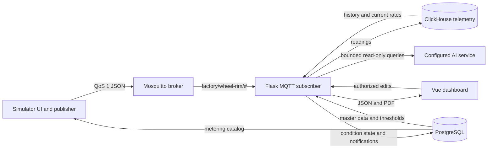

# Technical architecture

## Scope

The pilot monitors utility use in an illustrative wheel-rim factory. It provides visibility and advisory notifications. It does not actuate machines, change supply, or prove that a fault or leak occurred. All supplied historical and live demonstration readings are simulated.

## Components and data flow



- `app/`: Vue 3 application with Tailwind CSS 4 and Lucide icons. Vite builds `app/dist/`; Flask serves it at `/` and `/dashboard/`. Hash navigation preserves links such as `/#overview`. Vite's development server proxies `/api` to Flask.
- `api/`: Flask process serves the UI and API, owns the MQTT subscription, creates PostgreSQL and ClickHouse tables on startup, calculates live views and notifications, renders PDFs, and optionally calls a configured AI endpoint.
- `simulator/`: separate local Python HTTP server at port 8766. Its SQLite database holds slider values, enabled states, broker settings, and a short publish log. It syncs the dashboard's PostgreSQL metering catalog over HTTP using a narrow service token, then publishes current readings to MQTT.
- `api/compose.yaml`: runs PostgreSQL, ClickHouse, Mosquitto, and the dashboard API from sibling checkouts. The simulator is a local Python process with environment-based broker settings and a SQLite cache of slider values.

The browser talks to Flask, not directly to either database or MQTT. The app's `sensors` and `sensor_id` names are legacy protocol names; the UI uses “metering points”.

## Data ownership

| Data | Owner | Key objects |
| --- | --- | --- |
| Factory hierarchy | PostgreSQL | `factories` → `locations` → `production_lines` → `machines` → `sensors` |
| Production-flow map | PostgreSQL | `machine_flow_links`; saved left/right relationships, not surveyed coordinates |
| Fixed configuration | PostgreSQL | `sensors.baseline`, `min_value`, `max_value`, `meter_role`, `enabled` |
| Live and historical readings | ClickHouse | `telemetry`, keyed by `sensor_id` and UTC observation time |
| Historical expected bands | PostgreSQL | `metering_baseline_profiles`, one row per meter, weekday, and 15-minute local slot |
| Alert episodes and reviews | PostgreSQL | `metering_alerts`, `metering_condition_state` |
| Accounts and AI configuration | PostgreSQL | `app_users`, `app_settings`; AI key is encrypted before storage |
| AI chat history | PostgreSQL | `ai_conversations`, `ai_chat_messages`; each conversation belongs to one account |
| Slider and broker settings | Local SQLite | `data/sensors.sqlite3`, used only by the simulator |

The simulator sends current `value` and timestamp; it does not update the configured baseline or maximum. For dashboard-managed meters, the simulator catalog is refreshed from PostgreSQL. Deleting a dashboard meter removes it from the simulator catalog. A meter added only in the simulator stays local and does not become a PostgreSQL master record. The simulator's service token can read the catalog and change only a meter's enabled flag.

## MQTT contract

The default subscription is `factory/wheel-rim/#`. The simulator publishes one JSON message per enabled meter, usually every five seconds, with QoS 1. Example:

```json
{
  "sensor_id": "example-meter-id",
  "area": "Machining 01",
  "metric": "Electricity",
  "value": 42.5,
  "unit": "kW",
  "timestamp": "2026-10-18T05:00:00.000+00:00",
  "primary": false,
  "simulated": true,
  "quality": "good"
}
```

The API looks up `sensor_id` in PostgreSQL before accepting a reading. It stores the configured unit, not an untrusted unit from the payload, in ClickHouse. Unknown meters are ignored. ClickHouse records both `observed_at` and `received_at`, the MQTT topic, and whether a reading is simulated. MQTT is a transport; ClickHouse is the telemetry system of record.

## Baselines, rates, and reports

There are four distinct chart series: observed rate, configured baseline, historical expected rate, and operational maximum. The configured baseline and maximum come from PostgreSQL master data. The historical line is generated from three months of seeded synthetic readings, grouped by weekday and local 15-minute slot. Its expected rate and lower/upper band are not calibrated to real production. The source assumptions are in [the manufacturing audit](wheel-manufacturing-audit.md).

Electricity is shown as `kW`, not `kWh`; flows are rates such as `m³/h`, not volumes. Charts average observations within their display buckets and sum compatible consumption meters. Utility-system supply meters are kept separate to avoid counting their output again as end-use demand. Missing or stale readings are shown as unavailable, never as a measured zero.

Daily and monthly reports use Asia/Jakarta calendar boundaries. Observed quantities are estimated from sampled rates and covered time: nominally five seconds for live MQTT and five minutes for seeded history. Gaps are not filled. Reports state coverage and missing inputs. Actual output, employee shifts, tariff data, verified faults, and equipment capacity limits are not connected, so related KPIs remain unavailable.

## Notifications and AI

Configured-baseline, operational-maximum, sustained-maximum, and historical-band deviations generate separate advisory notification episodes. The API tracks meter zero duration and fresh readings from all enabled meters on a machine. It asks an operator to confirm off/on state or inspect a meter; only a user's confirmation changes machine master status. “Resolve” records an explanation; “Ignore” suppresses a duplicate until the condition ends. These events are investigation prompts, not verified anomalies.

AI chat is optional. A super admin configures an OpenAI-compatible chat-completions URL, model, and key. The application supplies an approved schema description, accepts bounded read-only SQL requests, executes them server-side with table allowlists and query limits, then sends limited results back for an answer. It renders structured visuals from query rows and sanitized Markdown, never executable model HTML. The provider receives the user's question, schema context, and query results; operators should choose a provider consistent with their data-sharing requirements.

Chat turns, generated visual definitions, and their query evidence are saved in PostgreSQL under the signed-in account. The left-side history reopens them after a refresh. The server builds follow-up context from stored messages rather than accepting browser-supplied history; one user cannot read or delete another user's conversations. Deleting a conversation also deletes its messages.

## Security and deployment notes

Dashboard API calls require a Flask session; mutations require a CSRF token. `super_admin` can manage users and AI settings, `admin` can manage master data and notifications, and `viewer` has read access plus AI chat. Password hashes are stored in PostgreSQL. Session, simulator-service, and AI-encryption secrets are generated in ignored `data/` files; these files are needed to preserve existing sessions, simulator synchronization, and saved AI credentials.

Compose ports are bound to `127.0.0.1` for the local pilot. The bundled Mosquitto configuration allows anonymous local connections, and sample database credentials are for local development. Before any network-facing deployment, add TLS, authenticated MQTT, managed secrets, backups, and a production WSGI server. The current Flask development server and in-process MQTT subscriber are intended for a single local instance; running multiple API replicas would create multiple subscriptions and potentially duplicate writes.

The API currently creates and conditionally updates tables at startup rather than using a versioned migration framework. Review schema changes and back up PostgreSQL and ClickHouse before upgrading a non-disposable dataset.
